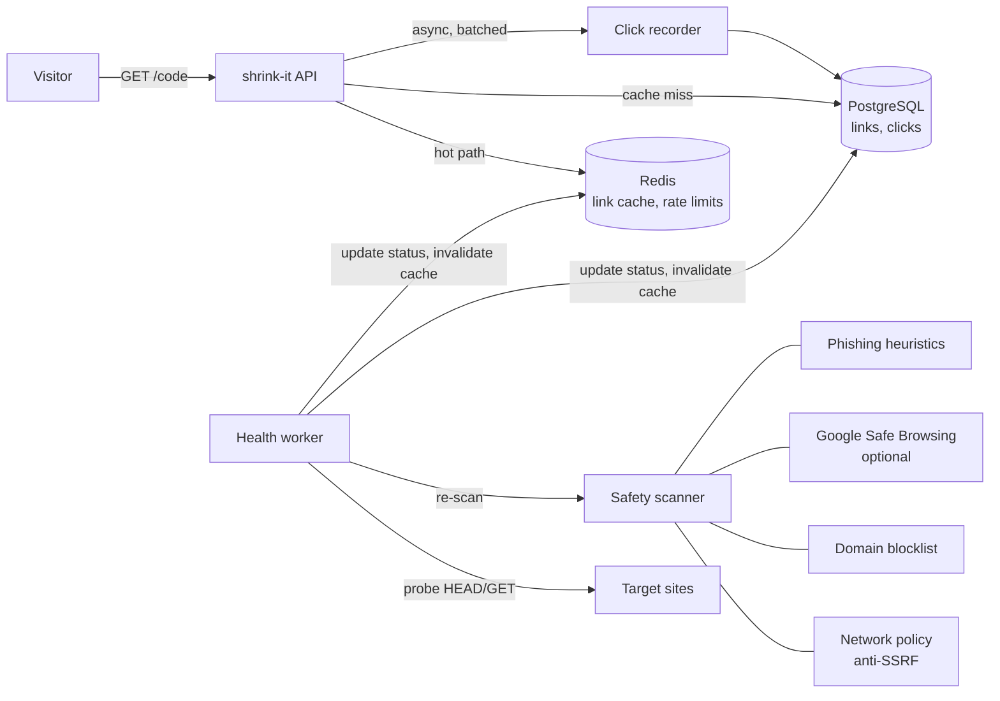

# shrink-it

[](https://github.com/doppIer/shrink-it/actions/workflows/ci.yml)
[](https://github.com/doppIer/shrink-it/actions/workflows/release.yml)
[](https://github.com/doppIer/shrink-it/pkgs/container/shrink-it)

A self-hosted URL shortener that **routes each visitor to the right place** and **refuses to send anyone somewhere dangerous or dead**.

Most open-source shorteners (YOURLS, Shlink, Kutt) map one code to one URL. shrink-it adds two things they mostly don't:

- **Smart routing.** One short link, many destinations: by device (iOS / Android / desktop), country, browser language, weekday and time window, plus sticky weighted A/B splits.
- **Link guarding.** Every destination is scanned before the link is created and re-scanned in the background. Targets are probed for health, and when one goes down the link quietly switches to a fallback URL. A link that becomes malicious later gets a warning page instead of a redirect.

Written in Go with PostgreSQL and Redis. One command and it runs.

## Install

You only need Docker. No clone and no build: this pulls the published image (amd64 and arm64, so it also runs on Apple Silicon and Raspberry Pi).

```bash
curl -fsSLO https://raw.githubusercontent.com/doppIer/shrink-it/main/deploy/docker-compose.yml
ADMIN_TOKEN=$(openssl rand -hex 24) docker compose up -d
```

Open http://localhost:8080. Keep the token: the API needs it as `Authorization: Bearer <token>`. To keep settings, put them in a `.env` file next to the compose file (`ADMIN_TOKEN`, `BASE_URL`, `PORT`, `POSTGRES_PASSWORD`, `SAFE_BROWSING_API_KEY`, ...).

Pin a version with `SHRINKIT_VERSION=0.1.0`, and upgrade with:

```bash
docker compose pull && docker compose up -d
```

Image tags on `ghcr.io/doppier/shrink-it`:

| Tag | Contains |
| --- | --- |
| `latest` | newest release |
| `0.1.0`, `0.1` | a specific release |
| `edge` | current `main` branch |

## Quick start from source

```bash
cp .env.example .env          # set ADMIN_TOKEN
docker compose up -d --build
./scripts/demo.sh             # creates a smart link and shows where different visitors land
```

Open http://localhost:8080 for a small web form, or use the API below.

```text
iPhone    -> https://www.apple.com/app-store/   (rule:ios)
Android   -> https://play.google.com/store      (rule:android)
Turkey    -> https://example.com/tr             (rule:turkey)
Desktop1  -> https://example.com/?v=b           (variant:2)
Desktop2  -> https://example.com/?v=a           (variant:1)
```

## Architecture



- **Redirects never wait on the database.** Links are read through a Redis cache; click events go into a buffered channel and are written to Postgres with `COPY` in batches.
- **Health worker.** Re-checks links every `HEALTH_INTERVAL`. After `HEALTH_FAIL_THRESHOLD` consecutive failures a link is marked `broken` and redirects use `fallback_url`. It recovers automatically.
- **SSRF protection.** Targets resolving to loopback, private, link-local or CGNAT ranges are rejected, and the health worker's HTTP dialer re-checks the IP at connect time, so DNS rebinding can't turn it into a scanner of your network.

## API

All `/api/*` routes need `Authorization: Bearer $ADMIN_TOKEN`.

| Method | Path | Description |
| --- | --- | --- |
| `POST` | `/api/links` | Create a link |
| `GET` | `/api/links` | List the latest 100 links |
| `GET` | `/api/links/{code}` | Link details, safety and health status |
| `DELETE` | `/api/links/{code}` | Delete a link |
| `GET` | `/api/links/{code}/stats?days=30` | Clicks by device, country, target, rule and day |
| `POST` | `/api/scan` | Scan a URL without creating a link |
| `GET` | `/{code}` | Redirect (302) |
| `GET` | `/{code}/preview` | Public preview page: destination, safety badges, warnings |
| `GET` | `/healthz` | Postgres and Redis status |

### Creating a smart link

```json
POST /api/links
{
  "url": "https://example.com",
  "code": "launch",
  "fallback_url": "https://example.com/status",
  "expires_at": "2027-01-01T00:00:00Z",
  "rules": {
    "rules": [
      { "name": "ios",       "when": { "devices": ["ios"] },        "target": "https://apps.apple.com/app/id123" },
      { "name": "android",   "when": { "devices": ["android"] },    "target": "https://play.google.com/store/apps/details?id=x" },
      { "name": "tr-office", "when": { "countries": ["TR"], "weekdays": [1,2,3,4,5],
                                       "hours": { "from": 9, "to": 18, "tz": "Europe/Istanbul" } },
        "target": "https://example.com/tr/live-support" },
      { "name": "german",    "when": { "languages": ["de"] },       "target": "https://example.com/de" }
    ],
    "variants": [
      { "url": "https://example.com/landing-a", "weight": 70 },
      { "url": "https://example.com/landing-b", "weight": 30 }
    ]
  }
}
```

How a destination is chosen:

1. Flagged as unsafe? Show the warning page, never redirect.
2. Target marked broken and a `fallback_url` exists? Use the fallback.
3. First rule whose conditions all match wins. Inside a list, any value matches (`["ios","android"]`).
4. Otherwise pick an A/B variant by weight. Assignment is a hash of IP, User-Agent and code, so a visitor keeps seeing the same variant.
5. Otherwise use `url`.

Each redirect carries an `X-Shrinkit-Reason` header (`rule:ios`, `variant:2`, `fallback`, `default`), and the same reason is stored with the click, so the stats show which rule actually fired.

**Country routing** reads `CF-IPCountry`, `X-Country-Code`, `X-Geo-Country` or `CloudFront-Viewer-Country`. Put Cloudflare or a GeoIP-enabled reverse proxy in front, and set `TRUST_PROXY=true`.

## Safety checks

| Checker | Blocks | Warns |
| --- | --- | --- |
| Network policy | localhost, private, link-local, CGNAT IPs (direct or via DNS) | domain doesn't resolve |
| Blocklist | domain or any parent domain listed in `blocklist.txt` (hosts-file format works, e.g. URLhaus) | |
| Google Safe Browsing | malware, phishing, unwanted software (set `SAFE_BROWSING_API_KEY`) | API unavailable |
| Heuristics | | raw IP host, punycode look-alike domain, deep subdomains, nested shorteners, plain HTTP, odd ports |

Warnings don't block creation. They are stored with the link and shown on its preview page.

## Configuration

| Variable | Default | |
| --- | --- | --- |
| `BASE_URL` | `http://localhost:8080` | Used to build `short_url` |
| `ADMIN_TOKEN` | *(empty)* | API token; empty means the API is open |
| `HEALTH_INTERVAL` | `15m` | How often each target is re-checked |
| `HEALTH_FAIL_THRESHOLD` | `3` | Consecutive failures before `broken` |
| `SAFE_BROWSING_API_KEY` | | Enables Google Safe Browsing |
| `BLOCKLIST_PATH` | | Domain blocklist file |
| `TRUST_PROXY` | `false` | Read client IP from `X-Forwarded-For` |
| `CREATE_RATE_LIMIT` | `30` | Link creations per IP per minute |
| `CACHE_TTL` | `10m` | Redis link cache TTL |
| `ALLOW_PRIVATE_TARGETS` | `false` | Allow internal URLs (intranet use) |

## Development

```bash
make test   # go test -race ./...
make lint   # go vet + gofmt
make up     # docker compose up --build
make logs
```

**Releasing:** push a version tag and the `release` workflow publishes the image.

```bash
git tag v0.1.0 && git push origin v0.1.0
```

```
cmd/server          entrypoint, wiring, graceful shutdown
internal/rules      routing engine (pure, fully unit-tested)
internal/safety     URL validation and scanner chain
internal/health     background prober and safety re-scan
internal/httpapi    REST API, redirect, preview pages
internal/analytics  batched click recorder
internal/store      Postgres access and embedded migrations
internal/cache      Redis cache and rate limiter
```

## Roadmap

- [ ] Dashboard with charts for stats
- [ ] Built-in GeoIP (MaxMind GeoLite2) instead of relying on proxy headers
- [ ] Webhook / email when a link goes broken or gets flagged
- [ ] QR code endpoint
- [ ] Prometheus metrics and a k6 load-test script

## License

MIT
